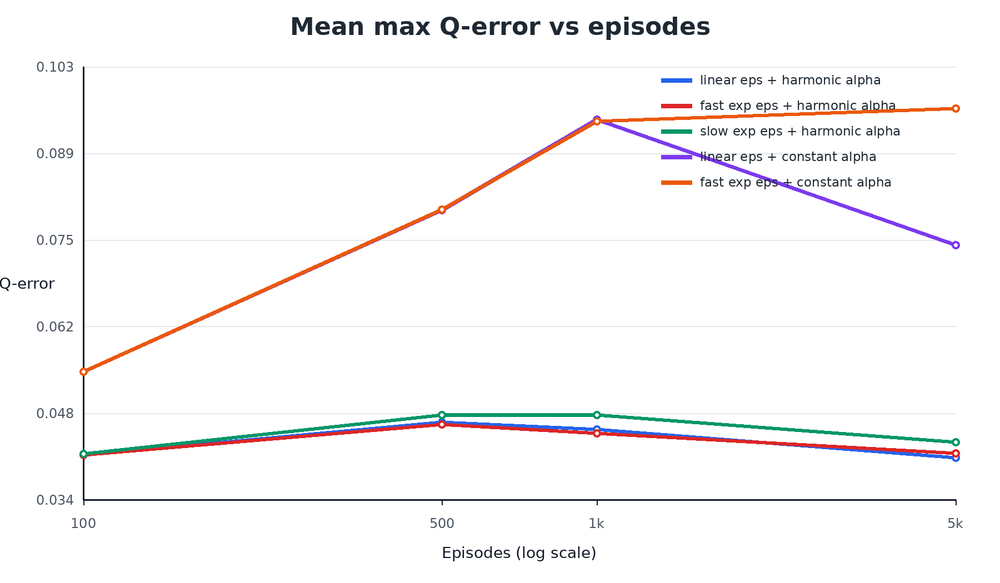
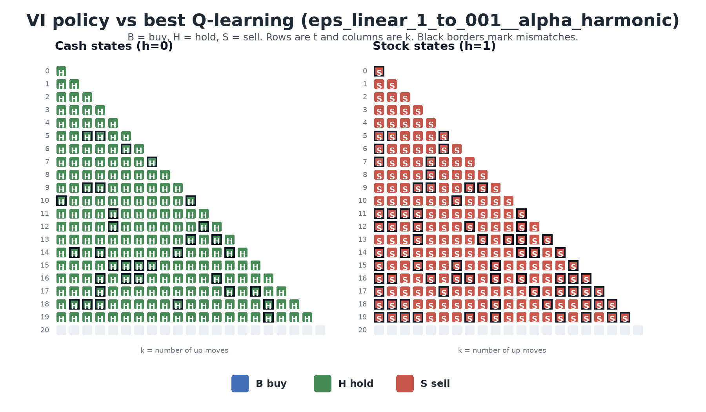

# RL for stock trading: value iteration vs. Q-learning

A small stock-trading problem set up as a finite-horizon MDP. I solve it exactly with backward
dynamic programming and then check how close tabular Q-learning gets under different exploration
and learning-rate schedules.

## Setup

- Horizon H = 20, starting price S0 = 100
- Each step the price goes up by u = 1.1 or down by d = 0.9, each with probability 0.5
- State is (t, k, h): time step, number of up moves so far, and whether I'm holding the stock (h = 1) or cash (h = 0)
- With cash I can hold or buy, with the stock I can hold or sell
- Reward is the log return of whatever I hold over the next step, no discounting

Since the price only depends on t and k (S_t = S0 * u^k * d^(t-k)), it doesn't need to be in the state.

One thing worth pointing out: u*d = 0.99 < 1, so the expected log return of holding the stock for
one step is 0.5*log(1.1) + 0.5*log(0.9), about -0.0025. Holding cash always gives 0, so the
optimal policy is to never buy and V*(s) = 0 everywhere. That makes it a decent test for
Q-learning, because the gap it has to learn from is tiny compared to the noise in each sample.

## What I ran

- Value iteration as the exact benchmark (ties broken as hold > buy > sell)
- Tabular Q-learning with epsilon-greedy exploration, only ever choosing valid actions
- 3 epsilon schedules (linear 1.0 to 0.01, slow exponential, fast exponential) x 3 learning rates
  (constant 0.1, 0.7/sqrt(1+n), 1/(10+n)), 50 seeds each, 5,000 episodes per seed

I compared each learned Q-table to the DP solution using max Q error, max V error, and the share
of states where the greedy policy disagrees with the optimal one.

## Results

Best combination was linear epsilon decay with the 1/(10+n) learning rate:

| metric | mean | std |
|---|---|---|
| max Q error | 0.0408 | 0.0050 |
| max V error | 0.0352 | 0.0056 |
| policy mismatch | 0.225 | 0.019 |

The 1/(10+n) learning rate was the best choice under every epsilon schedule. It satisfies the
usual Robbins-Monro conditions, while 0.7/sqrt(1+n) decays too slowly and the estimates keep
moving around. A constant learning rate sometimes had a lower policy mismatch but much larger Q
errors, so the greedy actions were mostly right even though the values weren't. The slow
exponential epsilon schedule was the worst overall since it was still exploring almost randomly
for most of the 5,000 episodes.





All 9 settings are in `results/experiment_summary.csv` and the full write-up is in `report/report.pdf`.

## Running it

```
pip install -r requirements.txt
python src/stock_trading_rl.py --episodes 5000 --seeds 50 --outdir outputs
```

Takes about a minute on a laptop. Use `--episodes 100000` for the longer run.

## Files

```
src/stock_trading_rl.py   environment, value iteration, Q-learning, plots
figures/                  plots used in the report
results/                  summary table, per-seed results, best setting
report/                   write-up (pdf and docx)
```
